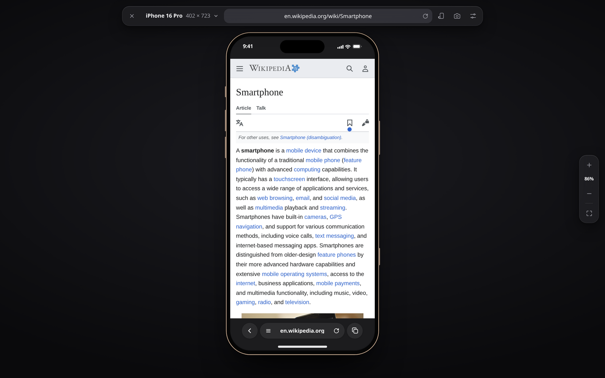
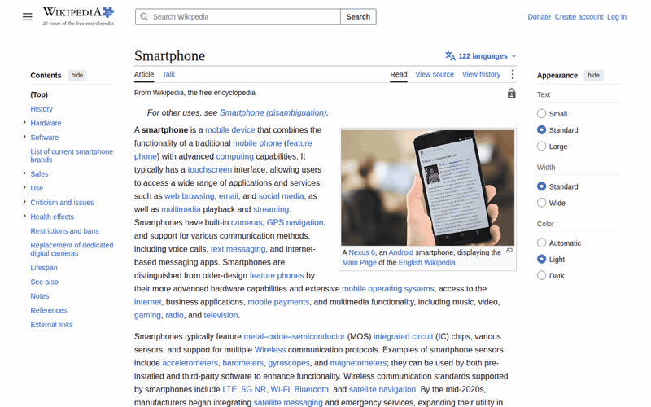

<div align="center">



# Mobile Simulator

**Test any website on iPhone, Android and tablet frames, right inside the tab you're already on.**

A Chrome extension that turns the current page into a realistic phone: real device sizes, mobile user agent,
touch scrolling, Safari and Chrome toolbars, rotation and pixel-perfect screenshots.


</div>

---

## Why

DevTools' device mode resizes the page, but it doesn't feel like a phone. Mobile Simulator puts the page inside a
real device frame, on the **same origin**, so your cookies, session and local storage keep working, and the address
bar never leaves your site. It's built for checking a layout quickly while you develop: click the icon, look, click
it again.

<p align="center"></p>

## Features

- **13 devices**: iPhone SE to iPhone 16 Pro, Galaxy S24, Pixel 8, Galaxy Z Fold 5, iPads and Galaxy Tab
- **Real device frames**: bezels, Dynamic Island, notch, punch-hole cameras and side buttons
- **Mobile identity**: mobile `User-Agent`, `Sec-CH-UA-Mobile` and `Sec-CH-UA-Platform` headers, plus
  `navigator.userAgent`, `platform` and `maxTouchPoints` in the page
- **Touch emulation**: the mouse acts as a finger, sending pointer and touch events in the order a touchscreen
  does, with momentum scrolling, scroll snapping and `touch-action` support
- **Browser chrome**: iOS 27 Safari (collapses as you scroll, as on a real iPhone), Chrome for Android, and
  iPad Safari
- **Display modes**: browser, installed PWA (`display-mode: standalone`) or fullscreen
- **Rotation, zoom and fit to window**: sharp at every zoom level
- **High-resolution screenshots**: captured at the device's real pixel density (2× or 3×) with a transparent
  background, ready for docs and app stores
- **Survives reloads**: stays open while your dev server hot-reloads, on the same page and scroll position
- **Light, dark or system theme**
- **15 languages**: English, Spanish, German, French, Italian, Portuguese (BR), Russian, Chinese (Simplified and
  Traditional), Japanese, Korean, Hindi, Turkish, Indonesian and Polish

## Devices

| Phones | Viewport | Tablets | Viewport |
| --- | --- | --- | --- |
| iPhone SE | 375 × 667 | iPad Mini | 768 × 1024 |
| iPhone 13 | 390 × 844 | iPad Air | 820 × 1180 |
| iPhone 15 | 393 × 852 | iPad Pro 12.9" | 1024 × 1366 |
| iPhone 15 Pro Max | 430 × 932 | Galaxy Tab S9 | 800 × 1280 |
| iPhone 16 Pro | 402 × 874 | | |
| Samsung Galaxy S24 | 360 × 780 | | |
| Samsung Galaxy S24 Ultra | 384 × 824 | | |
| Google Pixel 8 | 412 × 915 | | |
| Galaxy Z Fold 5 (unfolded) | 673 × 841 | | |

## Install

The extension isn't on the Chrome Web Store yet. To load it from source:

1. Clone this repository or [download it as a ZIP](../../archive/refs/heads/main.zip) and unzip it.
2. Open `chrome://extensions` and turn on **Developer mode** (top right).
3. Click **Load unpacked** and select the project folder.
4. Pin **Mobile Simulator** to the toolbar.

It works in recent versions of Chrome and other Chromium browsers (Edge, Brave, Arc).

## Usage

Click the toolbar icon on any page to open the simulator, and click it again (or press <kbd>Esc</kbd>) to close it.

| Action | How |
| --- | --- |
| Change device | Device name in the toolbar |
| Rotate | Rotate button |
| Zoom in / out | <kbd>+</kbd> / <kbd>−</kbd>, or <kbd>Ctrl</kbd> + scroll, or pinch on a trackpad |
| Actual size | <kbd>0</kbd> or click the zoom percentage |
| Fit to window | Fit button on the zoom bar |
| Scroll a large device | Mouse wheel over the stage |
| Screenshot | Camera button; the PNG is downloaded |
| Close | <kbd>Esc</kbd> or ✕ |

**Settings** (gear button): device frame, synced scrolling across rotation and device changes, touch scrolling,
theme and display mode.

## How it works

```
toolbar click ─▶ background.js ─▶ injects ui-template.js + sim.js into the tab
                      │
                      ├─ session rule for this tab only: mobile UA and client hints,
                      │  strips X-Frame-Options / CSP so the page can frame itself
                      │
sim.js (UI, shadow DOM) ◀──▶ background.js ◀──▶ relay.js ◀──▶ frame.js (inside the phone)
                                                 isolated world   page world: UA, touch,
                                                                  scroll, display-mode
```

- The phone is an `<iframe>` of the page itself, mounted in a closed shadow root, so the site's CSS and the
  simulator's styles never mix.
- Header changes are **session rules scoped to the tab**. They are removed when the simulator closes, when another
  page loads in the tab, or when the tab closes.
- The UI and the phone talk only through the extension, never through `postMessage`, so the page under test can't
  listen in.

## Permissions

| Permission | Used for |
| --- | --- |
| `declarativeNetRequestWithHostAccess` | Setting the mobile user agent and letting the page load inside the phone, only for the tab running the simulator |
| `scripting` | Injecting the simulator into the current tab |
| `storage` | Remembering your device, zoom and settings |
| `<all_urls>` host access | Working on any site you open it on, and taking screenshots |

Mobile Simulator collects no data and makes no network requests of its own. See the [privacy policy](PRIVACY.md).

## Limitations

- Chrome can't run extensions on `chrome://` pages or the Chrome Web Store.
- A site that restricts frames with a `<meta>` Content Security Policy (rather than a header) can't be navigated
  inside the phone.
- The simulator emulates a mobile browser in Chrome's engine. It doesn't replace testing on real Safari (WebKit)
  for engine-specific bugs.

## Project structure

```
manifest.json     extension manifest (MV3)
background.js     service worker: header rules, per-tab state, screenshots
sim.js            simulator UI: devices, layout, zoom, capture
ui-template.js    UI markup and styles
frame.js          runs inside the phone: UA, touch emulation, scroll sync
relay.js          bridge between frame.js and the extension
_locales/         translations (one messages.json per language)
icons/
```

There's no build step: the folder is the extension.

## Contributing

Issues and pull requests are welcome. To add a language, copy `_locales/en/messages.json` to
`_locales/<locale>/messages.json` and translate the `message` values. `<locale>` is a
[Chrome locale code](https://developer.chrome.com/docs/extensions/reference/api/i18n#locales) such as `pt_PT`
or `nl`.

## License

[MIT](LICENSE)
